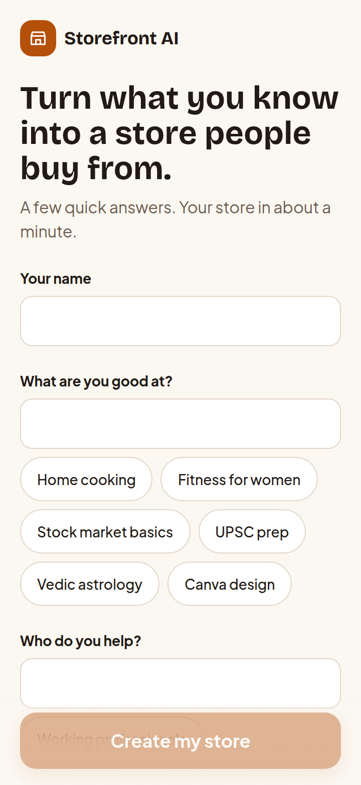
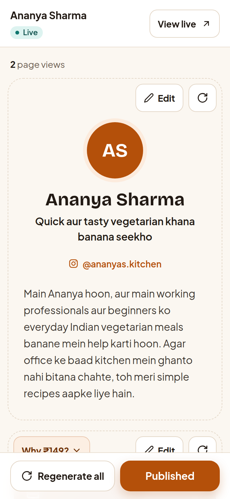
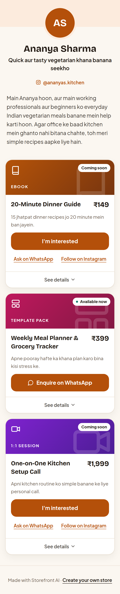
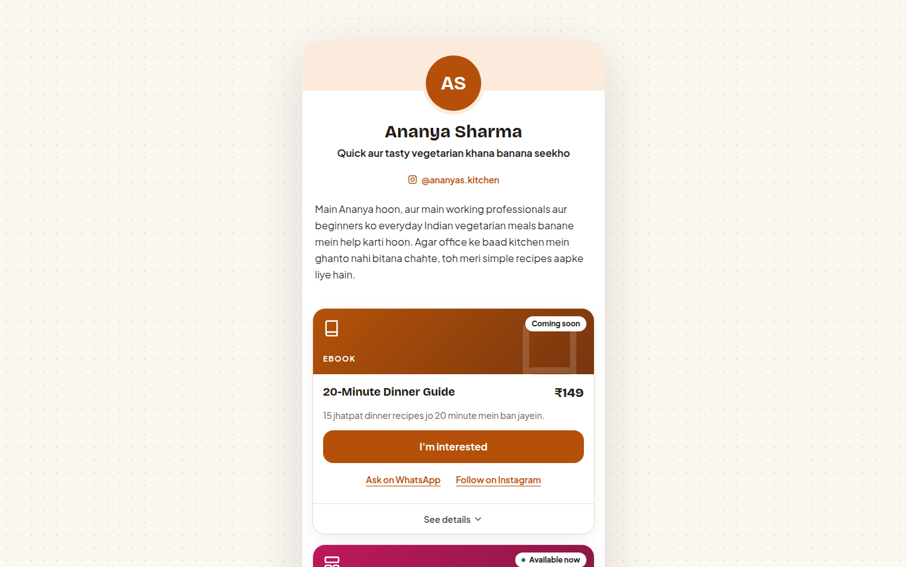

# BUILD_LOG — Storefront AI

Per slice: what was built, problems hit, decisions made, how AI tools were used. Feeds the decision doc.

---

## 🛠 Final fixes — Sun 22 Nov (after round 5)
Every change was deployed to production and checked there. Production is left at **0 stores, 0 events**.

| Commit | Fix | Verified |
|---|---|---|
| `d86a3dd` | **E8:** a tierReason never fails an attempt for length. It is trimmed to ≤ 200 chars (whole sentences, else a word boundary + full stop); Zod cap 160 → 200. Other fields keep the 15% rule. | unit tests; core gate **43/43** incl. E8 |
| env only | **Model order swapped** (3.5 Flash Lite returned 503 on most calls today): `GEMINI_MODEL=gemini-3.1-flash-lite`, `GEMINI_FALLBACK_MODEL=gemini-3.5-flash-lite` in Vercel production, then redeployed | the core gate's store was generated by `gemini-3.1-flash-lite` |
| `532b8ab` | README model table + `.env.example` match the new order | deploy green |
| `5f8e823`, `d2311c1` | Input screen: Instagram handle always visible, below the follower chips and outside the sentence card | 360 + 1440 checks; `round3-ui.mjs` 12/12 |
| `d520c68` | Input screen: "More options" removed; the result is the card's last line **"so they can"** (26 px heading label, small "(optional)", niche-aware chips, placeholder from the niche's first result chip or "e.g. cook dinner in 20 minutes"). Card: I'm → I teach → to → so they can; then followers → Instagram → Language → Create my store. Same in Edit answers; still optional end to end. | 360 px check; `round3-ui.mjs` 12/12 |
| `fa37a89` | **Stale "Continue your store":** S1 checks remembered stores (`GET /api/stores/<token>`, in parallel, 4 s timeout) and forgets 404s; no banner on a network failure; a dead edit link forgets its token and says "This store doesn't exist anymore. It may have been deleted." + Create a new store (public /s/ copy unchanged) | `qa/scripts/stale-banner.mjs` 3/3; `round3-ui.mjs` 12/12 |
| `9ed2ba1`, `c5c25d6`, `9dfdd7b` | Updated input screenshots; committed the stale-banner test, the QA harness `qa/scripts/lib.mjs` and its fixture store | — |

Review package: `../storefront-ai-review.zip` made with `git archive` from `HEAD` (committed files only: no `.env.local`, `node_modules` or private links; the only `.env*` is `.env.example`).

---

## 🛠 Round 5 — Sun 22 Nov, before submission
Tag `pre-round-5` = state before. Production left at **0 stores, 0 events**.

| Item | Commit | Result |
|---|---|---|
| Free-tier limits | `98f4f4d` | `gemini-3.5-flash-lite` and `gemini-3.1-flash-lite`: 15 RPM · 250K TPM · **500 RPD** each (AI Studio rate-limit view) → no second fallback; README notes the config-only switch to `gemini-3.8-flash` (free tier there: 5 RPM / 20 RPD) |
| Hinglish gender | `96a3837` | first-person gendered verb in a Hinglish bio/headline fails the primary attempt; fallback rewrites safe forms or accepts + logs; creator's own name excluded; prompt line added (prompts.ts + PROMPTS.md); unit tests |
| README | `8a16eb4` | repo link, setup, env var names, how AI tools were used |
| Regression | — | core gate **42/43** (E8: both models wrote a price reason > 184 chars on a single-product regenerate → old product kept with "Couldn't regenerate, kept your previous version.", the agreed round-3 behaviour); `round3-ui.mjs` **12/12** |
| 2 Hinglish generations | — | primary 503 → fallback ok both times; bios gender-neutral, gender check didn't need to fire (below) |

- Priya (female): "Mere saath aap seekhenge busy days mein bhi healthy khana banana. Office ke baad thakne ka bahana chhod kar fresh meals ready karein. Roz ka cooking ab stress nahi, bas 20 minute ka kaam hai."
- Rohit (male): "Mere saath aap busy schedule mein bhi strength build kar sakte hain. Ghar par bina heavy equipment ke workout routine follow karein. Mera focus hai aapko daily life mein fit aur strong rakhna."

---

## 🛠 Round 4 — Sun 22 Nov, overnight (design polish + 3 fixes + final regression; details in QA_REPORT §12)
Tag `pre-round-4` = state before. One deploy (items 0–3); final regression on production all green; production left at **0 stores, 0 events**.

| Item | Change | Commit | Verified |
|---|---|---|---|
| 0 | New Claude Design export + v5 tokens; 26 frames rendered to `Design/png/` (named by frame); TOKENS.md footer → "SPEC.md v5 wins on copy and behaviour" | `8b38b2b` | 26 PNGs |
| 1 | Design polish (visual only) to the v5 frames: S1 card + 26 px labels, sliding bar, interrupted / offline (Try again only when online) / follow-up card, editor top bar + ⋯ menu + tip tooltip + regenerate sheet + Undo toast + red Remove + Start over? dialog, buyer bar, publish sheet (switch rows, Required pill + Claude Design's reason copy, privacy line, pinned Publish), success screen (Share + Copy, Instagram line, View my live store, private block), public groups + indicative / chat-to-buy lines | `32ce7cb` | `qa/screenshots/final/` 42 PNGs vs frames; UI checks 12/12 |
| 2 | Raw follower labels in price reasons rewritten (No audience yet → "as a new creator", Under 5K → "with a small, early following", 5K–20K → "with a growing following", 20K+ → "with an established following", "the creator's audience size" → "your audience") | `51aa88d` | 11 unit tests |
| 3 | No price reason mentions the buyer → fails the primary attempt only (→ fallback); fallback accepted; logged (`generic tier reasons…` attempt error, `genericReasonsKept` in meta) | `42eada7` + `319e91b` (type fix — I committed `42eada7` with a type error and fixed it right after, before any deploy) | unit tests; 0 fires in 6 live generations |
| 4 | Final regression on production | — | core gate **43/43** · `round3-ui.mjs` **12/12** · E25 / E26 **pass** · 21 screens × 360 + 1440 screenshots · 2 confirmation generations (run twice by mistake → 4) |

**Confirmation generations (QA_REPORT §12):** cooking/Hinglish and finance for small business owners — primary model answered both times, every price reason names the buyer, no raw labels, all rules pass, v5 prices. **New finding:** in the second cooking run the Hinglish bio uses *"Main sikhata hoon"* (masculine) for Ananya — the gender rule is in the prompt but wasn't followed; not fixed (needs a decision: a deterministic check that fails the primary attempt, like item 3, is the obvious option).

**Decisions logged (round 4):**
- Design vs SPEC: SPEC wins on copy; where the frames only change layout I followed the frames — "Start over / Edit answers" now sits in ⋯ on desktop too (it was a top-bar button), the Start over confirmation keeps SPEC's text but is titled "Start over?" with a "Start over" button, the success screen drops the 🎉 and no longer prints the raw edit URL (Copy and the WhatsApp save still carry it).
- S1 keeps the sticky, keyboard-safe Create button (QA-07) instead of the frame's in-flow button.
- Offline: going offline while loading/generating shows the offline screen until "Try again", which is enabled only when `navigator.onLine` is true and then resumes polling.
- The bio regenerate sheet is titled "Regenerate your bio" (the frame only shows the product version).
- Item 3 ignores a few non-buyer words (with, from, their, …) when matching audience words.

**Mistakes, disclosed:** a summary command re-ran the eval (4 generations instead of 2) and the screenshot script also ran twice (no AI, cleans up after itself).

**Not done / open:** key rotation (item 0 of earlier rounds) — waiting for Parth's keys; Gemini 3.8 switch — waiting for billing; Hinglish gender slip above.

---

## 🛠 Round 3 — Sun 22 Nov (BUILD_ROUND_3; SPEC v5 / PROMPTS v5; details in QA_REPORT §11)
Tag `pre-round-3` = state before. Deploys after 1–3, 4–6, 7–9 (+ one for an eval fix); **core gate 43/43 after every deploy**; round-3 UI checks 12/12 and E25/E26 pass on production.

| Item | Change | Commit | Verified |
|---|---|---|---|
| — | SPEC v5 + PROMPTS v5 into the repo | `02f0df0` | — |
| 1 (V2) | PROMPTS v5 → `prompts.ts`; ≤ 15% over-limit trim at a word boundary, beyond → attempt fails | `9fed6e5` | `scripts/prompts-match.ts` 13/13 identical; unit tests |
| 2 (V7) | §7.5 v5 price table + written-out entry-eligibility map | `870f15b` | unit tests (table, map vs ≤ ₹499, ranges, ladder); live prices on prod |
| 3 (V2) | product regenerate validates the whole set (else keeps the old one + message); hint ≤ 120 in `<creator_hint>` | `b912eec` | unit tests; hint honoured in a live regenerate |
| 4 (V1) | input screen: stacked sentence fields, niche-aware chips, More options, optional result end to end | `4ad910b` | local 360 px; unit tests for the optional result |
| 5 (V3) | generating / interrupted / follow-up summary / offline / fade + one-time tip | `f720bd1` | local with seeded QA rows |
| 6 (V4) | Undo (10 s), Remove product, regenerate hint, Start over / Edit answers, AI-only re-pricing, phone top bar + ⋯, View as buyer, price line, "Your store preview" | `39f76e6` | `round3-ui.mjs` on prod; API checks for remove / re-pricing |
| 7 (V5) | one publish sheet, one-tap "Update live store", success only after a confirmed public load, share / Instagram / private-link-on-WhatsApp | `795f38f` | `round3-ui.mjs` on prod |
| 8 (V6) | Available now first, "Coming soon" subheading, buy line, indicative price, WhatsApp prefill title + price in the store's language, number re-validated at render | `a43c094` | `round3-ui.mjs` on prod; unit tests |
| — | eval fix: negated finance phrases ("no stock tips") are not advice | `af04782` | unit tests; finance re-run ok |
| 9 | mini eval (4 gens + 1 re-run) | — | QA_REPORT §11; then production cleaned to **0 stores, 0 events** |

**Decisions made (for Parth to confirm):** the 15% rule applies to tierReason too (the round-2 unlimited trim is gone: > 184 chars now fails over to the fallback model); a non-entry replacement for the only entry product is no longer silently re-tiered — the old product is kept; on phones the bottom action bar is gone (Publish is in the top bar, the rest in ⋯), and desktop also gets "View as buyer" in ⋯; result chips show only for the six known niches.

---

## 🛠 Round 2 — Sat 21 Nov evening (FIX_PROMPT_2; details in QA_REPORT §10)
One deploy round (re-deployed twice for fixes found by its own tests); **core gate 43/43** on the final build `caa90ab`; E25 + E26 pass; round-1 regression 5/5.

| Item | Change | Commit | Verified |
|---|---|---|---|
| 1 | SPEC v4.5 + PROMPTS v3 into the repo | `e121821` | — |
| 2 | PROMPTS v3 → `prompts.ts` | `2d954dd` | yes: system prompt (en, hinglish) + 3 generation-message variants identical to PROMPTS.md |
| 3 | Finance "safe"-type wording check | `c021332` | yes: 16 unit tests; 0 hits in the eval |
| 4 | T28 Edit answers & regenerate | `2cc92aa` + `27bde1f` | yes: E25 on prod (incl. restored-route path), public page unchanged until republish |
| 5 | T29 Delete store | `5d9e636` | yes: E26 on prod, wrong token → 404 |
| — | SPEC v4.5 S4 "Publish with / without WhatsApp" + regenerate accessible names | `6533ad2` | yes (prod UI) — the repo's old SPEC had the older wording, so this wasn't built yet |
| — | tierReason trim (PROMPTS v3 × SPEC §7.2 max 160) | `caa90ab` | yes: product regenerate 502 → 200 |
| 6 | Mini eval (4 gens) | — | all rules pass; no "safe" finance wording; Hinglish gender consistent/neutral; live formats lead with the live session; 10/12 tierReasons audience-specific |
| 7 | Cleanup to 0 stores | — | see final report |

**Open for Parth:** (1) key rotation (item 0) still pending; (2) tierReason length: keep the code trim, raise SPEC's 160 cap, or add a length to PROMPTS; (3) T29 "rate-limited like other writes" — no other write is rate-limited today (only generation); delete is token-gated and one-shot, so no extra limiter was added.

---

## 🛠 QA fixes — Sat 21 Nov (tag `pre-qa-fixes` = state before; details in QA_REPORT §9)
Deployed to production in 4 rounds (1–5 · A–F · 6–7 · 10); **core gate 43/43 after every deploy**.

| Item | Fix | Commit | Verified |
|---|---|---|---|
| 0 | Key rotation | — | **skipped at Parth's request** (keys still the pre-QA ones; `.env.local` confirmed git-ignored and never committed) |
| 1 | QA-01 functions in `hnd1` | `f9969c9` | yes (production `x-vercel-id: …::hnd1`) |
| 2 | QA-02 Instagram URLs + field errors | `a325470` | yes (prod UI + API, unit tests) |
| 3 | QA-04 long-text overflow | `ccd2735` | yes (60-char strings, 360 px, editor + public = 360) |
| 4 | QA-05 products sorted by price (code-enforced) | `db2b281` | yes (unit tests) |
| 5 | QA-06 `metadataBase` → absolute og:url | `c7dcde2` | yes (prod HTML) |
| A | IQA-02 "Thanks!" only after 2xx | `b2a5511` | yes (prod: network error / 500 / success) |
| B | IQA-01 + QA-08 `draft_rev`, changed-fields PATCH | `3fdb59b` | yes (prod: regenerate in tab A + bio in tab B both survive; 409 message) |
| C | IQA-03 no third question round | `df3eea7` | yes (prod: round-2 answer → ready; unit tests) |
| D | IQA-04 stale Why-₹ hidden after manual change | `8c7b9bf` | yes (prod UI) |
| E | IQA-05 check final DB write | `a27b163` | yes (real generation with a stolen claim → no write, `generation_failed(claim_lost)`) |
| F | IQA-06 letters in WhatsApp rejected | `1272254` | yes (prod API, unit tests) |
| 6 | PROMPTS.md v2 → `prompts.ts` | `a451417` | yes (system prompt identical to v2, en + hinglish) |
| 7 | QA-03/QA-10 `checkClaims` patterns | `047c199` | yes (29 unit tests; fired in the eval on "stock tips") |
| 8 | Eval re-run (12 inputs, production) | — | 12/12 correct status; 0 rule violations; see below |
| 9 | Delete `QA ` test data | — | yes: 60 stores + 310 events → 0 (13 older non-QA test stores left; not in scope) |
| 10 | QA-07 blur messages · QA-09 beforeunload | `2d4e7ea` · `d0c8281` | yes (prod) |

- **Latency (QA-01):** GET `/api/stores/<token>` median **1,747 → 416 ms**; tap → edit page **4.3 → 2.0 s**; tap → ready editor **8.8 → 5.4 s**.
- **Eval:** no invented backstory or finance advice in any stored output (the new check rejected one primary attempt with "stock tips"; fallback fixed it). ebook + template pack + workshop now in **3/9** ok-stores (was 9/15). UPSC 100K+ now has a **₹7,999 cohort** step-up.
- **Notes:** item C's final-round instruction is the only prompt text in code that isn't in PROMPTS v2. One Vercel GitHub webhook was missed (`047c199`); that deploy was created from the same commit via the Vercel API. Migration `0005_draft_rev` applied to the database. This phase used ~45 generation calls (3+ core gates, fix tests, 12-input eval).
- **Model note (pending):** when Gemini billing is verified, set `GEMINI_MODEL=gemini-3.8-flash` (fallback `gemini-3.5-flash-lite`), redeploy, run 3 generations.

---

## Code-enforced rules (added by QA fixes)
- **Product order (QA-05):** after the ladder check, `buildStoreContent` sorts products by price ascending (equal prices keep the model's order). This applies to full generation and Regenerate all. A single-product regenerate keeps its slot and does not re-sort. Previously only a prompt instruction.

## 🔎 QA run — Sat 21 Nov (full report: [QA_REPORT.md](QA_REPORT.md))
1. Verdict: **ready with issues** — no P0; core journey works end to end on production with real AI.
2. Results: **112 PASS · 7 FAIL · 0 BLOCKED · 0 NOT RUN** across journeys A–D and matrix areas A–G; 32/40 AI calls used.
3. P1 **QA-01:** functions run in `iad1` (US) while Supabase is in Tokyo → 1.3–1.9 s per API call, 11.5 s tap-to-store. Fix: `vercel.json` `"regions": ["hnd1"]` (S).
4. P1 **QA-02:** pasting an Instagram profile URL blocks creation with a generic "check your answers" (S).
5. P1 **QA-03:** one bio invented a personal fact ("after my own experience postpartum") (M, prompt).
6. P1 **QA-10:** finance store offered a portfolio review call / "safe stock" picks (M, prompt + check).
7. P2: long unbroken text overflows at 360 px, product order not enforced, relative `og:url`, no S1 field messages, two-tab stale overwrite, no unsaved-changes prompt.
8. Security, idempotency (double tap, lost response), stale-run recovery, draft/published split, events/throttles: all PASS.
9. Production untouched; preview left at `FORCE_AI_FAIL=0`; 3 kept stores listed in the report (edit links only in git-ignored `qa/PRIVATE_LINKS.md`).
10. Morning fix plan (~4–5 h, P1s ≈ 3 h): QA_REPORT §6.

---

## ☀️ Morning report — Sat 21 Nov

**Live:** https://storefront-ai-blush.vercel.app · showcase store: https://storefront-ai-blush.vercel.app/s/ananya-sharma-9h46
**Core gate on the live URL: 43/43 pass** (run twice: right after the slice 6 deploy and again on the final deploy). UI checks at 360 px and 1440 px on live: 24/24 pass.
**Rollback point:** git tag `slice-5-done` (not needed: nothing failed).

### Models (task 1)
Our key lists 19 Gemini models. I tested every Flash model with the exact production path (system prompt + generation prompt + union `responseSchema` → Zod → all deterministic checks), cooking persona, 3 calls each, stopping a model at its first quota error to save free-tier requests (`scripts/model-bench.mts`).

| Model | Works | Latency (3 calls) |
|---|---|---|
| **gemini-3.5-flash-lite** → `GEMINI_MODEL` | ✅ 3/3 | avg 3.0 s (2.97–3.05) |
| **gemini-3.1-flash-lite** → `GEMINI_FALLBACK_MODEL` | ✅ 3/3 | avg 4.7 s (4.0–5.3) |
| gemini-3.6-flash | ✅ 3/3 | avg 9.9 s, one call 21.2 s |
| gemini-3.5-flash | ✅ 3/3 | avg 16.3 s, up to 26.4 s |
| gemini-3.7-flash | ❌ | 504, then 429 free-tier quota |
| gemini-3.8-flash | ❌ | 503, then 429 |
| gemini-omni-flash-preview | ❌ | 429 |
| gemini-2.5-flash / 2.5-flash-lite | ❌ | 404 "no longer available" |

**Why:** 3.5 Flash-Lite is the fastest and steadiest and passes every check; 3.1 Flash-Lite is a different model (own quota) that also passes everything. The two non-lite Flash models work but have 21–26 s calls, which would trip the 22 s attempt-1 cap and waste the budget. Raw outputs: `scripts/out/bench-<model>.json` (e.g. 3.5 Flash-Lite: "Tasty everyday Indian vegetarian meals in under 20 minutes", ebook/low first; 3.1 Flash-Lite: "Roz ka khana, sirf 20 minute mein").
**Confirmed live:** a new store generated on the **first attempt** by gemini-3.5-flash-lite in 2.6 s model time (`scripts/first-attempt.mjs`, attempts logged in the DB). When billing clears, re-run `npx tsx --conditions=react-server scripts/model-bench.mts gemini-3.8-flash gemini-3.7-flash` and switch the env vars if 3.8 is fast enough — no code change needed.

### Slice 6 (task 2)
- Design export rendered to `Design/png/01…17-*.png` (Playwright + system Chrome; each board is an iframe, waited for content + fonts). Tokens in `Design/TOKENS.md` ("Haldi & Ink": paper/ink neutrals, 4 store accents, 7 format-cover gradients, Bricolage Grotesque + Plus Jakarta Sans), wired into the Tailwind `@theme`.
- Rebuilt as our own components (`components/ui.tsx`, `icons.tsx`, `store-view.tsx`, `sheet.tsx` + the screens). **No logic or API changes** — fetching, polling, PATCH/publish/regenerate calls and validation are untouched; SPEC copy kept where the design differs (e.g. "Add & publish" / "Skip, show "I'm interested" instead", not "Publish with/without WhatsApp").
- The requested behaviours, each checked by `scripts/ui-shots.mjs` / `scripts/ui-states.mjs` on live:
  - **Create button reachable with the keyboard open at 360 px:** sticky CTA + `interactive-widget=resizes-content` + scroll margin on fields. At 360×420 with a field focused, the button is fully visible and the field sits above it.
  - **Direction chip selects, "Use this" submits** (verified the POST carries exactly the selected chip; nothing is sent on chip tap).
  - **One badge + matching button per public card:** Coming soon → I'm interested (+ Ask on WhatsApp / Follow on Instagram links when present); Available now → Enquire on WhatsApp. Verified on a store with both.
  - **No placeholder text:** no `placeholder` attributes and no sample/design content anywhere; everything shown comes from the store's data.
  - **Regenerate dims the existing card** with a "Regenerating…" overlay (card count unchanged, one pill, failure → toast, card kept).
  - **Desktop frames at 1440:** public store in a 480 px frame on a dotted backdrop; editor with top-bar actions and the edit sheet as a right side panel below the bar, preview shifted left.
- Also checked: no horizontal scroll and all tap targets ≥ 44 px on S1, S3, S5; store fits in 2.1 screens at 360 px.

### Screenshots (live)
| S1 · 360 | S3 · 360 | S5 · 360 |
|---|---|---|
|  |  |  |

S5 · 1440: 
More in `docs/screenshots/`: S1 with keyboard, S2, S2b (chip selected), S2c retry + unclear, S3 regenerating, product sheet, S3 desktop side panel, S6.

### Not finished / for you
1. **Real-phone pass** (SPEC core gate requirement) — everything above is Playwright on desktop Chrome with mobile emulation. In particular **iOS Safari ignores `interactive-widget`**: the focused field scrolls into view, but the sticky Create button may sit behind the iOS keyboard until you dismiss it. Android Chrome should keep it above the keyboard. Worth checking on your phone.
2. **Gemini billing** still pending; the app runs on free-tier Flash-Lite quotas (separate per model, so primary + fallback cover each other, but a busy review day could still hit daily limits).
3. Not built (cut-first, SPEC §13): accent-colour picker (D16 — the design marks it optional), the remaining non-core edge cases. The D7 "rejected alternative" board is reference material for the decision doc, not a screen.
4. Test stores from the gate runs are in the live DB (slugs `ananya-sharma-*`, `meera-iyer-*`, `ravi-*`); harmless, but you may want to delete them before sharing the URL widely.

---

## Slice 0 — repo, schema, env, hello world, model check (Fri 20 – Sat 21 Nov)

### Built
- Next.js **16.4.6** (current stable; satisfies ≥ 15.1 for `after()`), React 19.3, TypeScript, Tailwind 4, `@google/genai` 3.6.1, Zod 4.6.7, `@supabase/supabase-js` 2.119.
- `supabase/migrations/0001_init.sql`: SPEC §6 exactly, plus v4.1–v4.4 constraints: `event_day` column (T1), `public_events_need_visitor` covering all three public events (T14/T24), `product_events_need_product` (T18), partial unique indexes for interest taps and daily views. RLS enabled on both tables with no policies; `anon`/`authenticated` grants revoked. Added (not in spec, harmless): `updated_at` trigger, an index on `(creator_ip_hash, created_at)` for the creation rate-limit query.
- `src/lib/ai/schemas.ts`: Zod schemas from SPEC §7.2 (source of truth) + Gemini `responseSchema` objects for the model-filled fields only (PROMPTS.md §5). Union sent as `anyOf`; flat fallback also defined.
- `src/lib/ai/prompts.ts`: PROMPTS.md v1 text verbatim as template functions; 500-char truncation per field.
- `scripts/model-check.ts`: real calls with the exact production schemas + prompt text, cooking persona (Hinglish). Raw outputs saved in `scripts/out/`.
- `scripts/migrate.mjs`: applies migrations via the session pooler (local only).
- `/api/health`: reports whether server env vars are present (booleans only).

### Model check results (Sat 21 Nov, ~00:30 IST)

| Model | Union schema | Flat schema | needs_more | Bio | Product | Latency |
|---|---|---|---|---|---|---|
| `gemini-3.5-flash-lite` | ✅ Zod ok | ✅ | ✅ | ✅ | ✅ | 1.7–4.1 s |
| `gemini-3.8-flash` | ❌ 503 | ❌ 503 | ❌ 503 | ❌ 503 | skipped | n/a — 503 "high demand" / 504 on every call, including a 2-word prompt, over ~3 runs |
| `gemini-3.7-flash` (probe) | ❌ 503 | ❌ 503 | ❌ 503 | ❌ 503 | skipped | n/a |
| `gemini-3.5-flash` (probe) | ✅ | ✅ | ✅ | ✅ | ✅ | 38–58 s (served as `gemini-3.6-flash`) — too slow for the 22 s primary budget |

- `responseSchema` **accepts the union** (`anyOf`) — no need for the flat schema so far (confirmed on Flash-Lite; to re-confirm on 3.8 Flash).
- `gemini-3.8-flash` exists in `models.list()`; the failures are capacity, not a bad id.

### Problems hit
- npm install on the Windows-mounted drive (`/mnt/d`) is slow (~10 min).
- One 3.8 Flash call hung **180 s** before returning 503. **Pipeline must pass an explicit per-call timeout** (`httpOptions.timeout` / AbortSignal) — the SDK's own retry/timeout won't respect our 22 s budget.
- `.env.local`: pooler string was pasted into `SUPABASE_URL`; moved to `SUPABASE_DB_URL`.
- Supabase project region is `ap-northeast-1` (Tokyo), not Mumbai. Fine for a prototype; adds ~100 ms per DB round-trip from India.

### Decisions
- Extra local-only env var `SUPABASE_DB_URL` (not in SPEC §14) for applying migrations; never set on Vercel.
- **Root cause found:** the Gemini key's project is on the **Free Tier** (429 `GenerateRequestsPerDayPerProjectPerModel-FreeTier`, limit 20/day for 3.8 Flash, exhausted by the retries). Free-tier traffic is also the first to get 503 under load. SPEC §7.1 already requires billing → Parth to enable billing on the AI Studio project, then re-run `scripts/model-check.ts`.
- **Open (Parth):** if 3.8 Flash still 503s on the paid tier, choose a primary model (spec change).

### AI tools
- Claude Code: scaffold, schema, prompt wiring, model-check script, running real calls.

### Deploy
- GitHub: https://github.com/parthsagar111-debug/storefront-ai (public). Commits use the GitHub noreply address.
- Vercel: https://storefront-ai-blush.vercel.app (`storefront-ai.vercel.app` was taken). Git-connected; pushes to `main` deploy.
- Env vars on Vercel (production + preview), all marked sensitive except `NEXT_PUBLIC_APP_URL`. `SUPABASE_DB_URL` is not on Vercel.
- Checks: `/` returns 200; `/api/health` shows gemini/supabase/salt present; the client JS bundle (~570 KB) contains neither the Gemini key nor the Supabase secret key (implementation check 3, re-run after each slice).

---

## Slice 1 — S1 → POST /api/stores → after() generation → /edit/[token] with polling (Sat 21 Nov)

### Built
- **S1** (`/`): 4 typed answers with tap-to-fill chips, audience size + language chips, optional Instagram. Client check only blocks empty / < 2 chars / one char ×5. Token (24 random bytes, base64url) + `clientRequestId` generated in the browser and saved to localStorage **before** the POST (T11); a new pair on every Create (T27). Unconfirmed submissions are re-sent with the same ids on the next visit (lost-response recovery). Storage blocked → the T22 message and a one-time edit link. "Continue your store" banner.
- **POST /api/stores** in T12 order: idempotency lookup (same id + same token → same store; other token → 409) → validate (Zod, 500-char truncation) → insert → `after(runGeneration)`. A concurrent duplicate hits the unique constraint and falls back to the lookup. Creation rate limit deferred to slice 5 (spec order).
- **runGeneration**: atomic claim (`claim_generation` SQL function, migration 0002) → primary → fallback within the 50 s budget (22 s cap on attempt 1, remaining − 3 s on attempt 2) → Zod → unique formats/titles → §7.5 pricing + ladder repair → write **only if this run still holds the claim** (`gen_started_at` match).
- **Stale detection on the DB clock**: `get_store_by_token_hash` returns `is_stale` from the same SQL thresholds the claim uses (pending > 15 s, generating > 75 s). The UI shows Retry only when `failed || isStale`.
- **GET /api/stores/[token]**, **POST /retry** (claims synchronously, so its response is truthful), **POST /answer** (S2b direction → pending → regenerate).
- **/edit/[token]**: polls every 2 s; skeleton + rotating lines + "Taking a little longer" after 20 s; S2b direction chips + free text; S2c unclear (back to S1 prefilled) and failed/stale (Try again); ready → `StoreView` (shared with the public page in slice 3); unknown token → "This store doesn't exist (yet)".
- Events written server-side: `generation_started`, `generation_completed` (model, attempts, latency), `generation_failed`, `followup_shown`.

### Tests (live URL)
- `scripts/smoke.mjs`: **E1** ready in 26 s (3 products: ebook ₹149 / template pack ₹399 / live workshop ₹499, Hinglish, unique formats, name from input, no hashes in the response); **E9** same ids → same slug, other token → 409, two concurrent POSTs → one row and **one** `generation_started`; **E11** unknown/malformed token → 404; `aaaaa` and bad token → 400; **E2** "fitness/people/get fit" → 3 directions → tap → ready in 10 s. 19/20 passed — the 1 failure was **both** models returning 503 (free tier); the store correctly went to `failed` → Retry.
- `scripts/recovery-test.mjs` (**implementation check 1**): forces 5 states in the DB and compares UI vs server. pending 5 s → no Retry; pending 20 s → Retry shown and accepted; generating 30 s → no Retry, server refuses (409); generating 80 s → Retry shown and accepted; failed → accepted. A second Retry never double-runs (409). **All passed.**
- Real UI at 360 px (in-app browser, live URL): chips → Create → generating → Hinglish store. No horizontal scroll (scrollWidth 360). Edit link saved and confirmed in localStorage.
- **Implementation check 3**: client JS for `/` and `/edit` (1.17 MB) contains none of the Gemini key, the Supabase secret key, the IP salt, or even the Supabase hostname.

### Problems hit
- `permission denied for table stores`: this Supabase project doesn't auto-grant new tables to API roles. Migration 0003 grants **only** `service_role`; anon/authenticated stay locked out.
- `@google/genai` retries **5×** with backoff by default (explains the 180 s hang in slice 0). Set `retryOptions.attempts = 1`; the pipeline owns retries.
- Free tier: 3.8 Flash returns 503/504/429 on almost every call, so every store currently comes from Flash-Lite after a 1–20 s wasted primary attempt. Billing is pending Google's identity verification; provider decision Saturday evening (Parth).
- Template dark-mode CSS made text unreadable on dark phones; pinned light theme until the slice 6 design handoff.
- React 19 lint (`set-state-in-effect`): polling/storage reads moved into callbacks.

### Decisions
- `unclear` is stored as `status = needs_input` + `follow_up.kind = "unclear"` (the status enum has no `unclear`; avoids a schema change). Retry isn't offered for it; the creator goes back to S1 with answers prefilled.
- `updated_at` marks when a row entered `pending` (insert / answer); nothing else updates a pending row, so it's the "unclaimed since" clock for the 15 s rule.
- Pulled from slice 2 because slice 1 can't work without them: fallback model, time budget, pricing + ladder. Left for slice 2: tierReason scrub, banned-claims regex, sensitive-domain keywords + disclaimers, `FORCE_AI_FAIL`.
- Max 2 needs_more rounds (S2b) is tracked (`follow_up.round`) but not enforced yet (slice 5).

### AI tools
- Claude Code: read the bundled Next 16 docs (`after`, Cache Components + Route Handlers, async params), wrote all code and SQL, ran the live smoke and recovery tests, drove the in-app browser at 360 px, read Vercel logs to find the grants issue.

---

## Slices 2–5 (Sat 21 Nov, built straight through at Parth's request)

### Slice 2 — deterministic checks, safety, demo switch
- `build-store.ts`: unique formats + titles; §7.5 pricing; ladder repair (move one entry-capable product to its highest ≤ ₹499 tier, else fail the attempt); `tierReason` sentences with ₹ / Rs / INR / 3+ digit numbers removed; banned claims (guaranteed, 100%, lakh/crore + earn, "certified"/"SEBI" unless in the input) fail the attempt; sensitive domain = model OR input keywords (T8) → disclaimer on every product.
- Product regenerate uses the same checks against the kept products; if the replaced product was the only entry product, the replacement is forced to an entry tier or the attempt fails (PROMPTS.md `mustBeEntry`).
- `FORCE_AI_FAIL` 1/2 in the pipeline.
- `scripts/checks-test.ts`: 24 unit checks, all pass.

### Slice 3 — publish, public store, CTAs, events, tap counts
- `POST /publish`: optional WhatsApp (normalized to 10 digits), full draft re-validation, T5 (Available now ⇒ number, incl. Skip) → `published` snapshot.
- `/s/[slug]`: reads only `published`; OG/Twitter meta (title = name · headline, description = bio); CTAs: Available now → Enquire on WhatsApp (`wa.me/91…?text=Hi <name>, I'd like to buy "<title>"`); Coming soon → I'm interested (once per browser, confirmation) + Ask on WhatsApp if a number exists, else Follow on Instagram if a handle exists; footer link to `/`.
- `POST /api/events`: visitorId required for all three (T24), productId for taps (T18); store must be published, product must be in the published snapshot, interest only for Coming soon, WhatsApp tap only with a number (T21); 30/hashed IP/store/hour (T3); duplicates dropped by the unique indexes.
- Editor: page views + "N interested · N WhatsApp taps" per product, "Taps show interest, not purchases." shown the first time.

### Slice 4 — editor
- Sheet component: bottom sheet on phones, side panel ≥ 768 px (D6). Header sheet (name, headline, bio, Instagram, WhatsApp + privacy line). Product sheet (availability, title, format select with used formats disabled → re-prices to typical, price ₹49–₹99,999 with suggested range + soft warning (D17), summary, description, 3 deliverables). Available now without a number asks for it inside the sheet.
- `PATCH`: merges into the draft, re-validates the whole draft incl. T5, `priceSource` = `creator` unless the price equals the table price for (format, tier); sets `has_unpublished_changes` only once published.
- `POST /regenerate` (bio / product / all), synchronous with inline pulse on that block only; failure → toast "Couldn't regenerate, kept your previous version." Regenerate all: confirm dialog; needs_more/unclear keep the draft and show the message (T25). Regenerated products get new ids (T20).
- "Why ₹X?" chip (tier reason or "You set this price" + typical range), soft hint when no product is under ₹500, Draft / Live / Unpublished changes badge, View live.

### Slice 5 — states, limits, not-found
- Creation limit 5/hashed IP/hour (after validation, before insert, T12); shared generation limit 30/store/hour on answer, retry, regenerate (T19).
- S2b: after 2 rounds the free-text box is hidden and the server only accepts one of the offered directions.
- S6 not-found for `/s/unknown`, `/edit/badtoken` and any unknown route.

### Tests (live URL)
- `scripts/core-gate.mjs` — **43/43 after the fix below**: E1, E8, E14 (edit + regenerate don't reach `/s/`; republish does), E15, E16, E17 (two taps → 1, second browser → 2), E18, E20, E21 (seeded 5 stores → 6th = 429, no AI call), E22, E23 (new ids, bio changed, name/WhatsApp kept, same edit link), E24 (public HTML renders with no token, OG tags, no token/hashes in HTML), E11, T5, T18, T19 (seeded 30 → 429), T21, T24, and check 3 (PATCH/regenerate/answer/retry/publish → 404 without the real token).
- **E5** (`FORCE_AI_FAIL=1`): store ready via `gemini-3.5-flash-lite`, logged attempts `[3.8-flash: FORCE_AI_FAIL=1, flash-lite: ok]`. **E6** (`=2`): `failed`, input kept → Try again. Switch reset to 0.
- UI at 360 px (in-app browser, live): editor, product sheet (used formats disabled, ₹2,999 soft warning, Cancel), Why ₹399 chip, Publish with a number → "Your store is live" + edit-link warning, Publish without a number → invalid "12345" inline error + privacy line + Skip → live, public page I'm interested → "✓ Thanks! Meera will see that you're interested.", no Ask on WhatsApp without a number, no horizontal scroll, store height 1.7 screens, "Continue your store" banner, S6 page.
- Check 3 re-run: 2.5 MB of HTML + client JS for `/`, `/edit`, `/s/…`, `/s/unknown` — no Gemini key, Supabase key, salt, Supabase host or Gemini endpoint.

### Problems hit
- **Gemini rejects deadlines < 10 s** (400 INVALID_ARGUMENT). On the 30 s section budget, a slow primary left the fallback 7 s → bio regenerate 502. Fix: attempt 1 is capped at `min(22 s, remaining − 13 s)` so the fallback always gets ≥ 10 s. Full generation is unchanged (22 s / ≤ 25 s); section regenerate becomes 17 s / ≤ 10 s. Small deviation from the §7.4 wording, same intent.
- Client components imported `schemas.ts`, which also held the Gemini `responseSchema` objects → would ship the Gemini SDK to phones. Split into `response-schemas.ts` (server-only).
- Public footer link was 18 px tall → 44 px.
- In-app browser pane was hidden during testing, so `requestAnimationFrame` never fired and React's streamed Suspense reveal didn't run (page stuck on "Loading…"). The server HTML was correct; verified by client-side navigation instead. **Needs Parth's real-phone check.**

### Decisions
- Regenerate endpoints are synchronous (≤ 30 s / 50 s inside `maxDuration = 60`) instead of going through the status/polling path: simpler, and the rest of the store stays usable.
- The current store sent to the model for regenerate contains no prices (PROMPTS.md: never insert rupee numbers).
- `/retry` and `/answer` can return 429 from the shared limit even when Retry is visible; the UI then says "Too many tries for this store." (the only case where Retry is shown but refused; documented).

### Not done / open
- Real-phone pass by Parth on the live URL (core gate requires it).
- Gemini billing/tier decision (Saturday evening): until then every generation spends 0.1–20 s on a failing 3.8 Flash call before Flash-Lite answers.
- Slice 6+ (Claude Design screens, remaining edge cases, colour picker).
